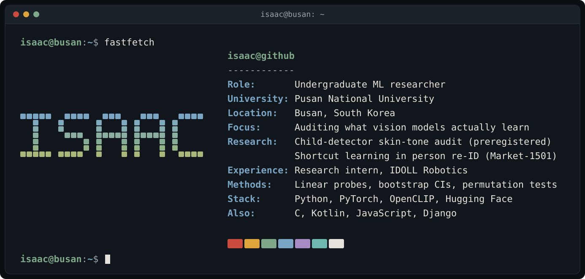

### Auditing what vision models actually learn

---

- 🔬 **Research:** I look for hidden failures in computer-vision models. Do child-safety detectors miss darker-skinned children? Do person re-ID models match clothing colour instead of identity? My audits are preregistered and come with confidence intervals and permutation tests.
- 🤖 **At IDOLL Robotics (Busan):** research internship building multimodal video + audio models for tic detection and human–robot interaction.
- 🌍 **Health ML for Africa:** privacy-preserving, federated anomaly detection for Parkinson's disease screening in Sub-Saharan Africa.
- 🧠 **Currently:** taking the child-detector audit from face datasets to in-the-wild images with Monk skin-tone annotation.

---

### 🚀 Featured projects

| Project | What it does | Stack |
|---|---|---|
| **Child-detector skin-tone audit**| Preregistered audit of five child detectors of the kind used to filter children out of text-to-image training data. Tests whether they miss Black children more often than White children, and why. The pilot points to age over-estimation of Black teenagers. | PyTorch · OpenCLIP · MiVOLO · Qwen2-VL · statsmodels |
| **[Re-ID shortcut audit](https://github.com/isaacmutuma/reid-shortcut-audit)** | Mechanistic audit of shortcut learning in a ResNet50 person re-ID baseline on Market-1501. Linear probes check whether the embedding encodes clothing colour, controlled perturbations test whether the model relies on it, and targeted interventions try to remove that reliance. | PyTorch · Torchreid · scikit-learn |
| **[Federated subset scanning](https://github.com/isaacmutuma/federated-subset-scanning-pads)** | Privacy-preserving, federated anomaly detection for Parkinson's disease screening from smartwatch movement data (PADS). Healthy volunteers share only differentially private histograms of a PatchTST encoder's activations, and each subject is scored against them with subset scanning. | PyTorch · PatchTST · scikit-learn · differential privacy |

---

<!-- Contact badges: hidden until the real URLs are filled in.

### 🤝 Let's connect

-->

